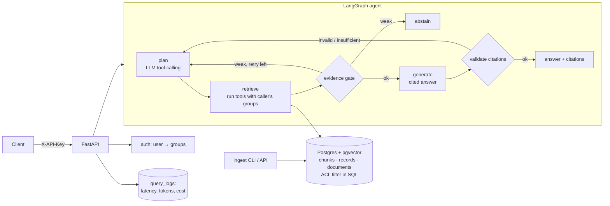

# Enterprise Research & Knowledge Agent

A research agent that checks permissions before it answers. It answers employee questions from internal documents and datasets, cites its sources, and **declines to answer when it can't find enough evidence**. It never shows anyone content their groups aren't allowed to read.

**Stack:** Python · LangGraph · FastAPI · PostgreSQL 16 + pgvector · sentence-transformers (bge-small embeddings + MiniLM cross-encoder) · any OpenAI-compatible LLM (Groq by default) · Docker

---

> **New here?** Follow [RUN_AND_DEMO.md](RUN_AND_DEMO.md) for a step-by-step Windows guide to running and demonstrating the project.

## What it does

| Requirement | How it's done |
|---|---|
| Ingest PDF, DOCX, web pages, internal docs | `app/ingest/loaders.py`: PDF (pages + numbered headings), DOCX (heading styles + tables), HTML / URLs (main content only, nav/footer stripped, SSRF guard), Markdown/TXT, CSV → structured rows |
| Hybrid search + reranking | `app/retrieval.py`: pgvector HNSW cosine **+** Postgres full-text (OR-query, `ts_rank_cd`) → **Reciprocal Rank Fusion** → **cross-encoder rerank** |
| Tools over multiple data sources | `app/tools.py`: `search_knowledge_base` (document chunks), `search_structured_data` (CSV/table rows), `list_documents` (catalog). The LLM picks tools through native tool calling. |
| Answers with citations | Sources are numbered `[S1]…`, and citations carry title, section, page, version and a snippet. Citations to unknown sources are removed, and each citation gets a lexical support score. |
| Detect insufficient evidence | Three checks: (1) a reranker-score **evidence gate**, (2) the model must reply `INSUFFICIENT_EVIDENCE` when the sources don't cover the question, (3) an answer with **no valid citation is rejected**. One query-rewrite retry happens before abstaining. |
| Document-level permissions | `allowed_groups && user_groups` is applied **inside every SQL query** (chunks, records, catalog, and again at hydration). Restricted rows never leave Postgres, so they can't leak via the prompt, the citations or the logs. Documents are default-deny, and ACL changes propagate atomically. |
| Benchmark (100–300 Qs) | **215 questions** in `eval/benchmark.jsonl` across 7 categories. Measures retrieval quality (hit@k, recall@k, MRR, nDCG, ablation of 4 modes), answer correctness, abstention, **ACL leak rate**, citation precision/recall, latency p50/p95 per stage, and token cost. |

## Architecture



**The retrieval pipeline for one tool call:** embed query → top-30 vector + top-30 keyword (both ACL-filtered) → RRF (k=60) → hydrate (ACL re-checked) → cross-encoder rerank of 30 → top-k.

## Quick start (Windows / PowerShell; bash works the same way)

```powershell
# 1. Database
docker compose up -d db

# 2. Python env
python -m venv .venv; .\.venv\Scripts\Activate.ps1
pip install -r requirements-dev.txt

# 3. Config: your existing .env works as-is (DATABASE_URL, GROQ_API_KEY, LLM_MODEL, EMBED_MODEL).
#    See .env.example for every option.

# 4. Load the sample corpus (18 docs: 4 PDF, 4 DOCX, 4 HTML, 3 MD, 3 CSV) and demo users
python -m scripts.ingest --manifest data/sample/manifest.json
python -m scripts.seed_users

# 5. Run the API → dashboard at http://localhost:8000 (raw API docs at /docs)
uvicorn app.main:app --reload
```

The whole stack also runs in Docker (the image bakes in both models):

```powershell
docker compose up -d --build
docker compose exec api python -m scripts.ingest --manifest data/sample/manifest.json
docker compose exec api python -m scripts.seed_users
```

### Try it

```powershell
$h = @{ "X-API-Key" = "demo-alice"; "Content-Type" = "application/json" }
Invoke-RestMethod -Method Post http://localhost:8000/ask -Headers $h -Body '{"question":"How many days of annual leave do I get?"}'
# alice (engineering) asking about exec-only content gets an abstention, not a leak:
Invoke-RestMethod -Method Post http://localhost:8000/ask -Headers $h -Body '{"question":"What is the Project Atlas purchase price?"}'
```

Demo users (dev only, defined in `data/sample/users.json`):

| key | groups |
|---|---|
| `demo-hammad` | everything + exec, **admin** (project owner) |
| `demo-alice` | all-staff, engineering |
| `demo-bob` | all-staff, finance |
| `demo-carol` | all-staff, legal, hr |
| `demo-dave` | all-staff, sales |
| `demo-erin` | everything + exec, **admin** |
| `demo-frank` | contractors only |

### API

| method | path | who | purpose |
|---|---|---|---|
| GET | `/health` | anyone | DB / pgvector / counts / active backends |
| GET | `/me` | user | your groups |
| POST | `/ask` | user | agent answer + citations + timings + cost (logged to `query_logs`) |
| POST | `/search` | user | raw hybrid search (`source`: documents \| structured, `mode`: vector \| keyword \| hybrid \| hybrid_rerank) |
| GET | `/documents?q=` | user | catalog, filtered by ACL |
| POST | `/ingest/file` | admin | multipart upload + `allowed_groups` |
| POST | `/ingest/url` | admin | fetch and ingest a web page |
| PATCH | `/documents/{id}/acl` | admin | change permissions (propagates to all chunks) |
| DELETE | `/documents/{id}` | admin | remove a document |
| POST | `/admin/users` | admin | create a user and issue an API key |

### Ingesting your own documents

```powershell
python -m scripts.ingest --path data/raw/finance --groups finance,exec      # whole folder
python -m scripts.ingest --path data/raw/handbook.pdf --groups all-staff
python -m scripts.ingest --url https://example.com/policy --groups all-staff
```

Re-ingesting is idempotent: unchanged content is skipped, changed content bumps `version` and replaces its chunks atomically, and a changed ACL is propagated. The content hash also covers the embedding model and chunk settings, so switching models re-embeds automatically.

## Benchmark

```powershell
python -m eval.run_benchmark                    # retrieval ablation + agent on all 215 questions
python -m eval.run_benchmark --judge            # also adds LLM-as-judge grading
python -m eval.run_benchmark --skip-agent       # retrieval only (no LLM cost)
python -m eval.run_benchmark --limit 50         # stratified subset
```

The report goes to `eval/reports/<timestamp>/report.md` (plus `summary.json` and per-question `results.jsonl`).

| category | n | what it tests |
|---|---|---|
| factual | 143 | single fact, single document, across all 4 file formats |
| table | 4 | facts inside DOCX/HTML tables |
| structured | 15 | answers that only exist in CSV datasets (tool routing) |
| multi_hop | 10 | needs 2 sources, often from 2 different documents |
| catalog | 3 | "which documents…" (catalog tool) |
| unanswerable | 20 | nothing answers it, so the agent **must abstain** |
| access_denied | 20 | the answer exists but the user lacks permission, so the agent must abstain **and leak nothing** |

Every gold evidence span is checked against the corpus, and every question's user is checked against the document ACLs when the benchmark is built (`python -m eval.build_benchmark`).

### Baseline results (offline backends, no LLM)

Measured in CI-style **offline mode** (`EMBED_BACKEND=hash`, `RERANK_BACKEND=lexical`, no `GROQ_API_KEY`). This is a no-model lower bound. Run the command above with your real `.env` to get the numbers for bge-small + cross-encoder + Llama 3.3. The full report is in `eval/BASELINE_offline.md`.

| retrieval mode | hit@1 | MRR@10 | nDCG@10 |
|---|---|---|---|
| vector | 86.0% | 0.920 | 0.934 |
| keyword | 87.8% | 0.926 | 0.938 |
| hybrid (RRF) | 87.8% | 0.934 | 0.945 |
| **hybrid + rerank** | **97.1%** | **0.984** | **0.981** |

End-to-end (extractive answering, no LLM): **84.2% overall accuracy**, **0.0% ACL leak rate** (0 restricted chunks retrieved), **95.2% citation precision**, 100% of answers cited, p95 latency 28 ms, $0 cost. Most of the remaining errors are things only an LLM can do: multi-hop synthesis (0/10 in extractive mode), paraphrased questions, and telling "Q3 2024" apart from "Q3 2026". Those are exactly what the LLM path is for.

## Tests

```powershell
pytest            # 44 tests; integration tests auto-skip if Postgres isn't running
```

The tests cover chunking boundaries and overlap, every loader, RRF, metrics, ACL enforcement in all 4 retrieval modes, permission-filtered catalog, versioned re-ingest and ACL propagation, abstention, and the API (auth, admin-only ingest, live ACL change). The LLM path is tested with a mocked model: tool-call planning, removal of invalid citations, `INSUFFICIENT_EVIDENCE` → abstain, uncited answers rejected, and cost tracking. Tests force the offline backends, so they need no model download or API key.

## Configuration highlights (`.env`)

| var | default | notes |
|---|---|---|
| `GROQ_API_KEY` / `GROQ_BASE_URL` / `LLM_MODEL` | Groq, `llama-3.3-70b-versatile` | any OpenAI-compatible endpoint; leave the key empty for offline extractive mode |
| `EMBED_BACKEND` | `sentence-transformers` | `hash` = offline, no download |
| `RERANK_BACKEND` | `cross-encoder` | `lexical` (offline) or `none` |
| `MIN_EVIDENCE_SCORE_CROSS_ENCODER` | `0.05` | abstention gate; tune it on the benchmark (watch false-abstention vs. hallucination rate) |
| `FINAL_TOP_K`, `CANDIDATES_PER_RETRIEVER`, `RRF_K` | 6, 30, 60 | retrieval knobs |
| `LLM_INPUT_PRICE_PER_MTOK` / `..._OUTPUT_...` | 0.59 / 0.79 | used for cost reporting |

## Project layout

```
app/
  agent.py          LangGraph graph: plan → retrieve → gate → generate → validate / abstain
  tools.py          tool specs + execution (groups injected from auth, never from the LLM)
  retrieval.py      vector + keyword + RRF + rerank, ACL in SQL, document catalog
  embeddings.py     bge-small (or offline hash embedder)
  rerank.py         cross-encoder (or offline lexical reranker), scores normalised 0..1
  llm.py            OpenAI-compatible client, tool calls, token/cost accounting
  ingest/           loaders.py · chunker.py · pipeline.py (versioning, dedupe, ACL propagation)
  auth.py           API keys (SHA-256) → user + groups; admin guard
  db.py             pool + idempotent schema migration on startup
  main.py           FastAPI app
db/init.sql         idempotent schema (safe on your existing volume; adds columns/tables)
scripts/            ingest CLI, seed users, sample-corpus generator
data/sample/        generated corpus (fictional company "Corvane Systems") + manifest + users
eval/               benchmark.jsonl, build_benchmark.py, run_benchmark.py, metrics.py
tests/              unit + integration + API tests
```

## Design notes and trade-offs

- **ACL at the database layer, not post-filtering.** Filtering after retrieval risks leaks through logs and prompts, and it starves top-k for low-privilege users. HNSW with a filter can return fewer than k rows under very selective ACLs, so `hnsw.ef_search` is raised to 100. On pgvector ≥ 0.8, enable `hnsw.iterative_scan` for strict guarantees.
- **The groups come from auth, never from the model.** Tool arguments the LLM controls are only query strings.
- **Abstention is multi-signal.** The cheap score gate catches "nothing relevant", the LLM instruction catches "relevant but doesn't answer", and citation validation catches "answered without grounding".
- **Prompt-injection hygiene.** Sources are wrapped in `<source>` tags and explicitly marked as data.
- **Structured data** is rendered into searchable text (`2026-07` → `2026-07 (July 2026)`, snake_case columns humanised), so the same hybrid retriever and the same ACLs work for tables.
- **Next steps:** SSO/OIDC group sync instead of API keys, conversation memory, streaming responses, async ingestion workers for large batches, and per-tenant evidence-gate calibration.
